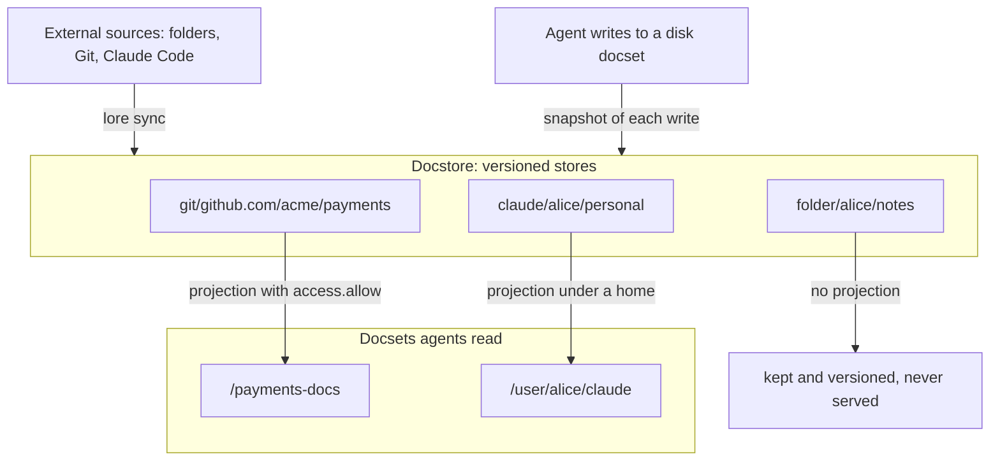

# Knowledge gateway

The knowledge gateway brings knowledge you keep elsewhere into OpenLore and shows it to agents as ordinary docsets, while the original stays where it is.

## The problem

Context that agents need is spread across tools. Coding rules live in a Git repository, Claude Code keeps instructions and memory next to each project, and notes sit in folders on laptops. Moving all of it into one knowledge repository means changing how every team member works, and the copies drift from the originals within days.

The gateway keeps the original authoritative. OpenLore holds a versioned copy, you decide which parts of it agents can read, and one command brings the copy up to date.

Learn more about [docsets](docsets.md).

---

## How it works

Two things sit at the centre: the **docstore**, where every external copy lives, and **docsets**, the directories agents read. A projection connects one to the other, and a store with no projection is kept but never served. Follow the arrows into the docstore to see how content arrives, and out of it to see what agents get.

### Docstore

The docstore is where the server keeps every document that did not start life in a docset. It is content-addressed and versioned per file: every sync creates a new snapshot of a store, snapshots share unchanged blobs, and each store's history is queryable. Stores are named by where their content came from.

| Store | Contents |
|---|---|
| `git/<host>/<org>/<repo>` | A synced Git checkout, owned by the first identity that synced it; a non-default port joins the host as `<host>_<port>` |
| `claude/<identity>/<project>/instructions` | One person's project instructions for Claude Code |
| `claude/<identity>/<project>/memory` | One person's project auto memory |
| `claude/<identity>/personal` | One person's personal Claude Code instructions and memory |
| `folder/<identity>/<name>` | One person's synced folder |
| `openlore/<docset>` | A snapshot of each native write to a docset |

A store is not a docset. Nothing in the docstore is listed, read or searched by agents until a projection names it; until then it is history that only its uploader can inspect.

### Projections and docsets

A projection is a docset whose contents come from a store. You declare it in `lore.json` with `"projection"` in place of `"path"`, and you can narrow it to a subpath or an include and exclude filter. A projected docset mounts, takes [grants](auth.md) and appears in the virtual filesystem like any other docset, and it is read-only on every transport.

Who can read a projection is decided by the docset's `access` block, the same way as for every other docset. A docset with no `access` block is reachable only as part of someone's home, so a store projected under `/user/<identity>/` is private to that person, and a store projected with `access.allow` roles is readable by everyone who holds one of them. One store can back several projections: the whole repository for maintainers and its `docs/` folder for everyone.

### How content gets in

Three kinds of **source** feed the docstore today: a **folder**, a **git** repository tracked at a branch, and **claude**, the instructions and memory Claude Code keeps for a project or for you personally. Each person declares theirs in `home/<identity>/sources.yaml` inside the knowledge repository, where `<identity>` is the name they log in with. The file is committed, so a teammate who clones the repository sees what everyone syncs, while the server's own settings stay in `openlore.yml` and `lore.json` at the root.

`lore sync`, run by the `lore` client installed beside `openlore`, reads that file, gathers the files each source has right now and pushes them as a snapshot: a manifest of paths and SHA-256 hashes, followed by only the blobs the server has not seen before. Which snapshot each person last pushed is tracked in `.local/`, outside version control.

Native writes take the other road in. When an agent writes to a disk docset, the server records the result in `openlore/<docset>`, so a docset that was never synced still has a history in the docstore.

Learn more in the [lore CLI reference](../reference/lore-cli.md).

### Agents

Agents read a projected docset as a directory in the same virtual filesystem as everything else, over SSH, MCP or HTTP. The `lore sources` command in the agent shell lists which docsets came from outside and which snapshot they show.

Learn more about [transports](transports.md).

---

## Trade-offs

Syncing is a command you run. The copy is as fresh as the last `lore sync`, which keeps the client free of background processes and makes every update attributable to the identity that ran it.

The client does the fetching. Git clones and Claude Code files are read on your machine with your credentials, so the server never needs access to GitHub or to your home directory.

Visibility is opt-in. Nothing in the docstore is served until a projection names it, which means one extra step before agents see new content and no chance of a synced folder leaking by default.

Native writes are snapshotted after they land. A write to a disk docset is recorded in `openlore/<docset>` once the filesystem write is durable, so a failure to record provenance is logged and does not undo the write.

---

## Next steps

- [Import knowledge](../start/import-knowledge.md) walks through connecting a folder end to end.
- [Import a Claude project](../how-to/import-claude-project.md), [import your Claude memory](../how-to/import-claude-memory.md) or [import a Git repository](../how-to/import-git-repository.md).
- Look up every command in the [lore CLI reference](../reference/lore-cli.md).
